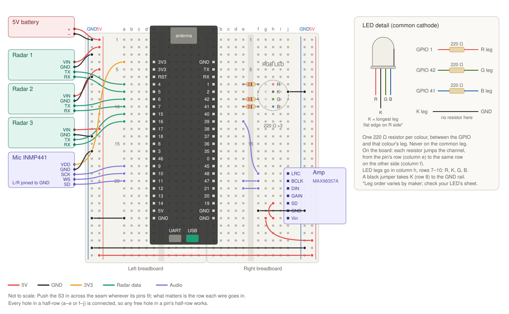

# Phygital Sensor Hub

Firmware and app for CampSight, a safety device for backpackers. An ESP32-S3 reads three DFRobot C4002 radars and a microphone running an Edge Impulse footsteps model, and sounds an alarm when a person approaches. It reports over Wi-Fi to an MQTT broker (EMQX Cloud, already set up), which our web app and a history recorder connect to.

| Path | What it is |
| --- | --- |
| `phygital/` | The sketch to upload (includes a patched radar driver) |
| `ei-project-v2-footsteps-arduino-1.0.2-impulse-#2.zip` | Edge Impulse model (Arduino library) |
| `app/` | Web app: phone app and admin dashboard |
| `server/` | Recorder (stores history) and a device simulator |

## Hardware

ESP32-S3-DevKitC-1-N8R2, 3× DFRobot C4002 radar (SEN0691), INMP441 mic, MAX98357A amp + speaker, 3.7 V lithium battery on a 5V charge/boost module (V713).




- Everything runs from the 5V rails, including the S3 (row 24 → 5V rail). Row 25 → GND rail shares ground.
- Ground the amp to the GND rail, not an S3 GND pin, or the board restarts.
- Battery: red to the module's **+** pad by the coil, black to **−**. The module's **5V +/−** pads feed the rails. Its USB-C port only charges.
- Pull the row 24 jumper before plugging the S3 into a computer.

## Getting started

1. **Arduino IDE 2.x.** Install **esp32 by Espressif** (3.x) in Boards Manager, and **arduinoFFT**, **PubSubClient** and **ArduinoJson** (7.x) in Library Manager. Add the model with **Sketch → Include Library → Add .ZIP Library**.
2. **Tools settings:**

   | Option | Setting |
   | --- | --- |
   | Board | ESP32S3 Dev Module |
   | USB Mode | Hardware CDC and JTAG |
   | USB CDC On Boot | Enabled |
   | Flash Size | 8MB |
   | Partition Scheme | 8M with spiffs |
   | PSRAM | QSPI PSRAM |

3. **Secrets.** Copy `phygital/secrets.example.h` to `phygital/secrets.h` and fill in Wi-Fi and the device's broker login. `secrets.h` is git-ignored; never put real values in the example file.
4. **Upload** `phygital/phygital.ino` through the S3's port labelled **USB**. If the upload fails, hold **BOOT**, tap **RST**, release, and retry. Press **RST** afterwards. Serial Monitor runs at 115200.

On Harvard Wi-Fi, register the MAC address printed at boot at [getonline.harvard.edu](https://getonline.harvard.edu), then leave the device unpowered for 5 minutes. Use SSID `Harvard University` with an empty password.

## How it alerts

Radar motion is the main signal; the sound model (human footsteps, animal footsteps, background noise) decides what the motion is. Each moment falls into one of three categories:

1. **Person** (motion plus human footsteps or unclear sound): after 1 s, the speaker beeps faster as they get closer.
2. **Animal** (motion plus confident animal footsteps): silent, logged to history.
3. **Nothing.**

The rules and thresholds are in `phygital/alert_logic.h`. Test changes without the board:

```bash
c++ -std=c++17 -o /tmp/alert_test tests/alert_logic_test.cpp && /tmp/alert_test
```

## Web app

Live at <https://gracemelcher.github.io/phygital/> (phone app in an iPhone frame) and [`/admin.html`](https://gracemelcher.github.io/phygital/admin.html). Pushing changes in `app/` to `main` republishes it. Run it locally with:

```bash
python3 -m http.server 8000 --directory app
```

In the phone app, tap the connection status to connect over the internet, over USB (Chrome, localhost only), or with demo data.

The phone app (`app/phone.html`) follows the Figma file "Phygital Wunderkammer" (page Prototypes); its artwork in `app/img/f/` is exported from Figma as SVG. To show a design state without a device, open `phone.html#mock=` plus `arm-alert`, `arm-armed`, `arm-disarmed`, `arm-disconnected`, `controls-cons`, `controls-med`, `controls-full`, `history` or `history-selected`.

## Recorder

Stores history in SQLite and serves it to the app. History is only saved while it runs.

```bash
cd server && npm install
cp config.example.json config.json   # add the recorder's broker login
node recorder.mjs
```

## Troubleshooting

| Symptom | Fix |
| --- | --- |
| Compile error about ESP32-S3 or USB CDC | Check the Tools settings |
| Serial Monitor blank | Use the **USB** port, not UART |
| Board restarts after `Speaker ready.` | Amp is grounded through the S3; move it to the GND rail |
| App says offline but radars are lit | S3 has no power; check the row 24 jumper |
| `Radar N FAILED` | LED off: no 5V to the radar. LED on: check its TX/RX wires |
| Wi-Fi won't connect | 2.4 GHz only; on Harvard, register the MAC and wait 5 minutes unpowered |
| `MQTT ... state 4/5` | Wrong login in `secrets.h` |
