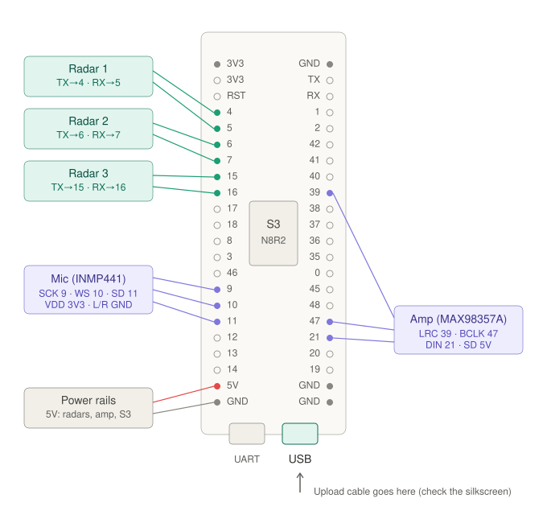

# Phygital Sensor Hub

An ESP32-S3 motion alarm. Three DFRobot C4002 radars track whether someone is coming closer or moving away, and a microphone runs an Edge Impulse model that listens for footsteps. An RGB LED and a speaker react locally. Readings go over Wi-Fi to an MQTT broker, where our own web app (phone screens plus an admin dashboard) shows them live and changes the device's settings. A small recorder service stores the history.

| Path | What it is |
| --- | --- |
| `phygital/` | **The sketch to upload.** Includes the patched C4002 radar driver |
| `ei-project-v2-footsteps-arduino-1.0.2-impulse-#2.zip` | Edge Impulse footsteps model (Arduino library) |
| `app/` | Web app: `index.html` (phone screens) and `admin.html` (admin dashboard) |
| `server/` | Recorder (stores history), device simulator, local test broker config |
| `dashboards/` | Old ThingsBoard dashboard exports (no longer used) |

## Hardware

ESP32-S3-DevKitC-1-N8R2, 3× DFRobot C4002 radar (SEN0691), INMP441 I2S mic, MAX98357A I2S amp + small speaker, common-cathode RGB LED, 3× 220 Ω resistors, a 5V supply for the radars and amp (USB power bank or 5V battery pack).

Pin numbers are the GPIO numbers printed next to each header pin. Each radar's **TX goes to the ESP32's RX pin** (the first number) and its RX to the ESP32's TX.

| Part | Pin → ESP32-S3 | Header side |
| --- | --- | --- |
| Radar 1 | TX→4, RX→5, VIN→5V rail, GND rail | left |
| Radar 2 | TX→6, RX→7, VIN→5V rail, GND rail | left |
| Radar 3 | TX→15, RX→16, VIN→5V rail, GND rail | left |
| Mic | SCK→9, WS→10, SD→11, L/R→GND, VDD→3V3 | left |
| Amp | LRC→39, BCLK→47, DIN→21, Vin→5V rail, SD→Vin, GND→GND rail (GAIN unconnected) | right |
| LED | R→220 Ω→1, G→220 Ω→42, B→220 Ω→41, common→GND | right |

- Radars and amp need **5V**, not 3V3, from a **separate 5V supply** on the rails. The S3 runs from USB. On these clone boards the 5V header pin gives no power out (its IN-OUT solder jumper is open), so leave it unconnected.
- One jumper joins the S3's GND to the GND rail so everything shares a ground. Everything else grounds to the rails. The amp in particular must **not** ground through an S3 GND pin: when the amp switches on, its current would flow through the S3 and restart it.
- Leave these pins free: 0, 3, 45, 46 (boot), 19, 20 (USB), 43, 44 (USB-serial chip), 35–37 (used by PSRAM on some S3 modules), 38, 48 (on-board LED).
- The board has two USB-C ports. **Use the one labelled USB** (not UART) for uploading and the Serial Monitor. Radar 3 borrows the UART port's serial channel.

## Getting started

1. **Arduino IDE 2.x + ESP32 boards.** In Boards Manager install **esp32 by Espressif** (3.x). Then set these **Tools** menu options (the sketch refuses to compile without the first two):

   | Tools option | Setting |
   | --- | --- |
   | Board | ESP32S3 Dev Module |
   | USB Mode | Hardware CDC and JTAG |
   | USB CDC On Boot | Enabled |
   | Flash Size | 8MB (64Mb) |
   | Partition Scheme | 8M with spiffs (3MB APP/1.5MB SPIFFS) |
   | PSRAM | QSPI PSRAM |
   | Port | the board on the **USB** port |

2. **Libraries.** In Library Manager install **arduinoFFT** (Enrique Condes, 2.x), **PubSubClient** (Nick O'Leary) and **ArduinoJson** (Benoit Blanchon, 7.x). Then **Sketch → Include Library → Add .ZIP Library** and pick `ei-project-v2-footsteps-arduino-1.0.2-impulse-#2.zip`.
   You do **not** need to install the DFRobot_C4002 library; the patched driver ships in `phygital/`.
3. **Wi-Fi registration (Harvard).** Upload once with any Wi-Fi values; the Serial Monitor prints `Wi-Fi MAC address: XX:XX:...` at boot. Register that address at [getonline.harvard.edu](https://getonline.harvard.edu) as a device without a browser. Then **unplug the device for at least 5 minutes**; until then the network keeps it in the unregistered role. In step 5 use `WIFI_SSID "Harvard University"` and `WIFI_PASS ""` (open network; access is by MAC).
4. **MQTT broker.** Set one up as described in [Broker setup](#broker-setup) and note the device's username and password.
5. **Secrets.** Make your own copy of the secrets template. Run this from the repo folder, or duplicate the file in Finder and rename it:

   ```bash
   cp phygital/secrets.example.h phygital/secrets.h
   ```

   Open `phygital/secrets.h` (it also appears as a tab in Arduino IDE) and fill in `WIFI_SSID`, `WIFI_PASS` (2.4 GHz networks only), the broker's `MQTT_HOST`, and the device login as `MQTT_USER` / `MQTT_PASS`. `MQTT_CLIENT_ID` is the device's name in the app (e.g. `phygital-01`). The sketch reads `secrets.h`, and git ignores it, so your values never get committed.
   Never put real values in `secrets.example.h`. That file is committed, so it is public; it only shows which values are needed.
6. **Upload.** Open `phygital/phygital.ino` and click **Upload**, then open the Serial Monitor at **115200 baud**. If the port doesn't show up or the upload fails, hold **BOOT**, tap **RST**, release **BOOT**, and upload again; press **RST** afterwards to start the sketch.

At boot you should see `Speaker ready`, `Sound AI ready`, `PSRAM: found`, `Mic ready`, `Radar 1/2/3 connected`, `Wi-Fi connected`, `MQTT: connecting... connected`, then a status line every 0.25 s.

### If you use the DFRobot_C4002 library instead

The stock library (v1.0.0) parses radar reports incorrectly on ESP32 boards. If you install it from [GitHub](https://github.com/DFRobot/DFRobot_C4002) rather than using the bundled copy, edit `Documents/Arduino/libraries/DFRobot_C4002/src/DFRobot_C4002.h`. At the end of the `sDetectResult_t` struct (around line 208), change

```cpp
} sDetectResult_t;
```

to

```cpp
} __attribute__((packed)) sDetectResult_t;
```

Re-apply this edit after any library update. (`phygital/DFRobot_C4002.h` is the patched header, if you'd rather copy it over.)

## Remote settings

Change these from the app (Arm and Controls screens, or the admin dashboard's Settings card). Under the hood the app publishes all four as one retained JSON message on `phygital/<device>/settings`. The device applies them right away, saves them so they survive a reboot, and reports what it's using as `active_*` values in its `info` message. Because the message is retained, a device that was offline picks up the latest settings when it reconnects.

| Key | Type | Default | Range |
| --- | --- | --- | --- |
| `perimeter_m` | number | 6.0 | 1.5–11 m alarm radius |
| `volume` | number | 0.01 | 0–1 (0.01 is very quiet; doubling it is about 6 dB louder) |
| `alarm_on` | boolean | true | speaker on/off |
| `led_on` | boolean | true | LED on/off |

Other tuning (trend threshold, AI confidence, beep speeds) lives at the top of `phygital.ino`.

## MQTT topics and telemetry

`<device>` is `MQTT_CLIENT_ID`. All payloads are JSON except `status`.

| Topic | Direction | Contents |
| --- | --- | --- |
| `phygital/<device>/telemetry` | device → app | changed sensor values (table below) |
| `phygital/<device>/info` | device → app, retained | firmware, MAC, Wi-Fi signal, sensor health, `active_*` settings |
| `phygital/<device>/status` | device → app, retained | `online`, or `offline` (set by the broker if the device drops off) |
| `phygital/<device>/settings` | app ↔ device, retained | `perimeter_m`, `volume`, `alarm_on`, `led_on` |
| `phygital/<device>/cmd` | app → device | `{"hello":true}` (resend everything), `{"preview":true}` (one beep) |
| `phygital/_history/req`, `phygital/_history/res/<id>` | app ↔ recorder | history requests and answers |
| `phygital/_recorder/status` | recorder → app, retained | `online` / `offline` |

Telemetry values are sent when they change (checked every second), plus everything every 30 s.

| Key | Values |
| --- | --- |
| `r1_state`, `r2_state`, `r3_state` | `moving`, `still`, `none`, `offline`, `no_data` |
| `r1_dir`, `r2_dir`, `r3_dir` | `approach`, `away`, `same`, `none` |
| `r1_dist_m`, `r1_speed_mps`, `r1_energy` (same for `r2_`, `r3_`) | only while a target is present |
| `perimeter`, `nearest_m` | `clear` / `inside` / `leaving`; nearest distance while inside |
| `sound_label`, `sound_score`, `footsteps` | model's top label, confidence, `1` when footsteps ≥ 70 % |
| `mic_state`, `mic_level`, `mic_peak_hz` | `quiet` / `sound` / `loud`, raw level, peak frequency |
| `led` | `red` (closer), `green` (away), `blue` (same distance), `off` |

## Web app

Published at <https://gracemelcher.github.io/phygital/> (phone app) and <https://gracemelcher.github.io/phygital/admin.html> (admin). `.github/workflows/pages.yml` republishes `app/` whenever it changes on `main`; it needs repo **Settings → Pages → Source: GitHub Actions** turned on once.

To run it locally instead, serve the `app/` folder and open it in a browser:

```bash
python3 -m http.server 8000 --directory app
```

Then go to <http://localhost:8000> for the phone app and <http://localhost:8000/admin.html> for the admin dashboard. Both are plain HTML files, so they can also be hosted on any static site (GitHub Pages, Netlify). USB only works from `localhost` or `https`.

### Phone app (`index.html`)

Three screens:

- **Arm** turns the alarm on or off (`alarm_on`).
- **Controls** sets the detection range and alarm volume, and plays a preview beep. Conservative is 3 m, Medium 6 m and Full Protection 10 m (`perimeter_m`). The volume slider runs 0–100 on a log scale (1 ≈ 0.005, 13 ≈ 0.01, 50 ≈ 0.07, 100 = 1.0).
- **History** shows the closest distance over time and an activity list. Over the internet it comes from the recorder (last 7 days of events); otherwise from the browser's own copy (last 3 hours). Export as CSV.

Tap the connection chip at the top right, then:

- **Connect over internet:** enter the broker's WebSocket address (`wss://<deployment>.emqxsl.com:8084/mqtt` for EMQX Cloud), the app's username and password, and the device name. The app reconnects automatically next time.
- **Connect over USB:** reads the board live over its **USB** port, with no Wi-Fi. Needs **Chrome or Edge**. Quit Arduino IDE first, because its Serial Monitor locks the port. Pick `USB JTAG/serial debug unit`.
- **Use demo data:** simulated readings, so you can try it with no board.

### Admin dashboard (`admin.html`)

A desktop page for the same broker:

- **Device health:** online or offline, last message, firmware, MAC, Wi-Fi signal, and each sensor's status.
- **Settings:** exact alarm radius and volume, armed, LED, and a preview beep.
- **Readings:** every telemetry value, live, with how long ago each one changed.
- **Charts:** radar distances, mic level and footstep confidence over 15 minutes to 7 days.
- **Logs:** an event log, plus a raw message log (live, or stored by the recorder).

The device menu lists every device seen on the broker.

### Over USB

The sketch prints each telemetry message as a line starting `@T ` and device info as a line starting `@A ` (the same JSON as MQTT). It accepts one JSON object per line, the same as the `settings` and `cmd` topics. The data sources live in `app/sources.js` (`MqttSource`, `UsbSource`, `DemoSource`); the screens don't care which one is connected.

## Broker setup

The device, the recorder and the app all connect to one MQTT broker. [EMQX Cloud](https://www.emqx.com/en/cloud/serverless-mqtt)'s free Serverless plan is enough (1 million connection-minutes and 1 GB of traffic a month; set the spend limit to $0). There's nothing to install: the broker runs on EMQX's servers.

1. Create a free account and a **Serverless** deployment. Note its address (like `abc123.ala.us-east-1.emqxsl.com`). The device uses port **8883** (MQTT over TLS) and the browser uses **8084** (WebSocket over TLS, path `/mqtt`).
2. Under **Access Control → Authentication**, create three username/password logins (client IDs are set by the code, not here): one for the device (put it in `secrets.h`), one for the recorder (put it in `server/config.json`), and one for the app (type it into the app). Separate logins mean you can change the app's password without re-flashing the board.

Other brokers work too (HiveMQ, a Mosquitto server). If its certificate doesn't chain to DigiCert Global Root G2, put its root certificate in `secrets.h` as `MQTT_CA_CERT`; see `phygital/mqtt_ca.h`. Everything broker-specific on the device is in `phygital/mqtt_link.h`.

## Recorder (stored history)

`server/recorder.mjs` subscribes to every device, stores readings and events in a SQLite file (`server/phygital.db`), and answers the app's history requests. It needs Node 22.5 or newer and must be running for history to be kept. It can run on any always-on computer (a laptop, a lab machine, or a small cloud server).

```bash
cd server
npm install
cp config.example.json config.json
```

Fill in the broker address and the recorder's login in `config.json`, then start it:

```bash
node recorder.mjs
```

It keeps 30 days of readings and events, and 2 days of raw messages (`keepDays`, `keepRawDays` in `config.json`).

### Testing without hardware or a cloud broker

`server/` also has a local test setup: a Mosquitto config with WebSockets on port 9001, and `simulate.mjs`, a fake device that publishes exactly what the board does. In three terminals, from `server/`:

```bash
mosquitto -c mosquitto-dev.conf
```

```bash
PHYGITAL_CONFIG=config.local.json node recorder.mjs
```

```bash
PHYGITAL_CONFIG=config.local.json node simulate.mjs phygital-sim
```

Then connect the app to `ws://localhost:9001` with device `phygital-sim` and no username or password.

## Troubleshooting

| Symptom | Fix |
| --- | --- |
| `Project_v2_footsteps_inferencing.h: No such file` | Add the Edge Impulse .zip library (step 2) |
| `secrets.h: No such file` | Copy `secrets.example.h` to `secrets.h` (step 5) |
| `#error ... ESP32-S3` or `... USB CDC On Boot` | Fix the **Tools** settings in step 1 |
| Serial Monitor is blank | Cable is in the **UART** port, or USB CDC On Boot is disabled |
| `PSRAM: NOT found` | **Tools → PSRAM → QSPI PSRAM** |
| Board prints nothing after upload, or `Detected size(8192k) smaller than ...` | Flash Size is set larger than the chip. The N8R2 has 8 MB: set **Flash Size → 8MB** and **Partition Scheme → 8M with spiffs** |
| Crashes or `Sound AI FAILED` at boot | **Tools → PSRAM** is off. Set it to **QSPI PSRAM** |
| Radar shows `no_data` or nonsense distances | Unpatched DFRobot library is being used; see the section above |
| `Radar N FAILED` | Radar LED off: no 5V reaching its VIN (check the 5V supply on the red rail). LED on: radar TX goes to the ESP32's RX pin (4, 6, 15) |
| Restarts every few seconds right after `Speaker ready.` (`Started after: power on`) | The amp's ground returns through the S3. Ground the amp to the GND rail, join the two GND rails directly, and connect the S3 to the rails only through its row 25 GND jumper (see "On a breadboard") |
| Wi-Fi never connects | Use a 2.4 GHz network; check the name and password. On Harvard, register the MAC, then leave the device **unpowered for 5 minutes** so the network moves it to the registered role |
| `Wi-Fi: refused, reason 2 (AUTH_EXPIRE)` while the network is visible | The board can hear the access point but isn't heard back. `mqtt_link.h` lowers transmit power (`WiFi.setTxPower`) for this; if it persists, move closer or try `WIFI_POWER_5dBm` |
| `MQTT ... failed (state -2)` | Can't reach the broker: check `MQTT_HOST`, `MQTT_PORT` 8883 and `MQTT_TLS 1`; a broker whose certificate doesn't chain to DigiCert Global Root G2 needs `MQTT_CA_CERT`; or the network blocks port 8883 |
| `failed (state 4/5)` | Wrong `MQTT_USER` / `MQTT_PASS` |
| App: "Could not reach the broker" | Use the WebSocket address: `wss://<deployment>.emqxsl.com:8084/mqtt` (not 8883) |
| App History says "browser" instead of "recorder" / admin shows "Recorder offline" | Start `server/recorder.mjs`; check its `config.json` login |
| Footsteps never detected | Check `FOOTSTEP_LABEL` matches the model's label; try `MIC_SHIFT` 13 |

## Wiring diagram



Hollow pins are unused. Power wires (5V, 3V3, GND) to each part are listed in the [Hardware](#hardware) table rather than drawn. Check pin numbers against the labels printed on your board.

### On a breadboard

The S3 is too wide for one breadboard, so snap off the power rails where two half-size breadboards meet and join them; each board keeps its outer pair of rails. Push the S3 in with its left pins in column **e** of the left board and its right pins in column **a** of the right board.


- **Left board:** the S3 covers columns f–j, so every wire goes in columns a–d of the pin's row. Data wires go in column a.
- **Left rails:** the 5V supply's + goes in the left 5V rail and its − in the left GND rail. Jumper the S3's GND row (25, column a) to the left GND rail. Leave the S3's 5V row (24) unconnected. The radars and the mic's GND take power from these rails. The mic's VDD goes straight to the S3's 3V3 row (4), and its L/R pin is joined to its GND on the module.
- **Right rails:** run one jumper along row 30 from the left 5V rail to the right 5V rail, and another along row 29 from the left GND rail to the right GND rail. Don't connect the right GND rail to an S3 GND pin.
- **Amp (plugged in):** its 7 pins go in column j, rows 19–25, in Adafruit's order (LRC, BCLK, DIN, GAIN, SD, GND, Vin). GAIN stays unconnected; loudness is set by `volume` instead. Check your board's printed labels, since some clones differ. Then add:
  - three jumpers across the centre channel, from column e of the S3's pin rows to column f of the amp's rows: GPIO 39 (row 12) to LRC (row 19), GPIO 47 to BCLK (row 20) and GPIO 21 to DIN (row 21);
  - a jumper from the amp's GND row (row 24, column f) to the right GND rail beside row 24, **not** to the S3's GND pin in column e;
  - a jumper from SD (row 23) to Vin (row 25), and one from the Vin row to the right 5V rail.
- **LED (right board):** each 220 Ω resistor jumps the centre channel, from the pin's row (column e) to the same row on the other side (column f). The LED's legs go in column h, rows 7–10 (R, common, G, B), and the common leg goes to the GND rail.
